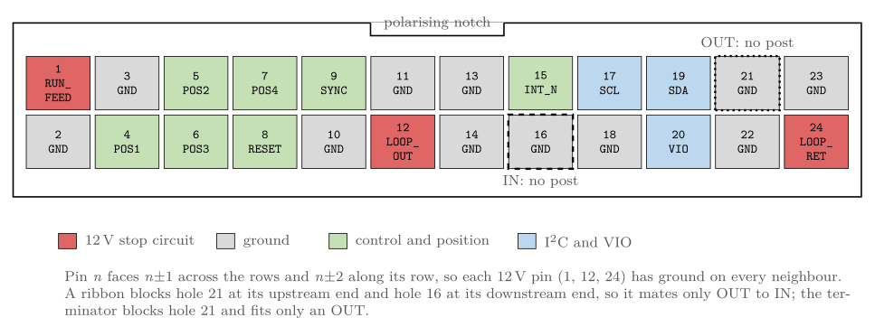
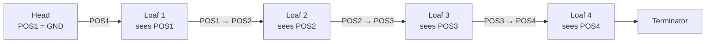

# 02 Connectors

[RFC 0001](README.md) · previous: [01 System](01-system.md) · next:
[03 Bus and MCU site](03-bus.md)

## Slot connector

**CON-1** The slot connector MUST be a 2×12 at 2.54 mm with the map above:
vertical male on the loaf, right-angle female on the slice. The slice's bus
connector is J1.

| Pos | Row A | Row B |
| --- | --- | --- |
| 1 | GND | GND |
| 2 | V_ACT | V_ACT |
| 3 | KEY_A | GND |
| 4 | V_LOGIC | GND |
| 5 | GND | KEY_B |
| 6 | GND | GND |
| 7 | GND | RESET |
| 8 | INT_N | SYNC |
| 9 | VKEY | SLOT_ID |
| 10 | SCL | GND |
| 11 | SDA | VIO |
| 12 | RSV1 | RSV2 |

### Card guide and keys

An unshrouded header can't locate the board it mates with. Every offset and
row shift that leaves a key hanging off the end of the header seats, and some
of those put V_ACT, V_LOGIC or VIO on the wrong pin. No key placement fixes
that, so the guide is part of the loaf.

**CON-2** Every G3 slot MUST carry a card guide on the loaf: a U-guide closed
on both sides (the bread-mechanical backplane part's U-guides become part of
the loaf standard). The guide MUST engage before the pins touch. A printed
bench guide does the same for bare-board work.

**CON-3** Row keys: at KEY_A and KEY_B the loaf omits the post and the slice
blocks the socket hole. With position and row fixed by the guide, the keys
block the one misinsertion left, a reversed board.

**CON-4** Voltage key: a 24 V loaf fits a post at 9A (VKEY) and a 12 V loaf
leaves it out. A slice whose V_ACT loads are 12 V only MUST block hole 9A, so
it seats only on a 12 V loaf; every other slice MUST leave 9A open.

### Contacts

The two V_ACT pins carry 1.5 A each at the full 3 A, against a contact rating
of about 3 A. Return current goes through the two ground pins beside them, 1A
and 1B, and the slice's other ground pins share it if one opens.

**CON-5** Slices and loafs MUST leave RSV1 and RSV2 (12A, 12B) unconnected. A
later standard that uses them, for example for CAN, defines their routing, and
it MUST keep fault voltages off SDA and VIO beside them, which the buffer can't
take above 6 V. CAN on a G3 slice today goes on the slice's own connector, for
example an MCP2515 over SPI as
[can-nano-shield](https://github.com/feastorg/can-nano-shield) does, never
through the G3 bus.

**CON-6** Insertion and removal happen with the loaf powered off.

### Mechanical checks still open

- The 2×12 body is ±15.24 mm. The case window grows to about ±17.9 mm,
  leaving about 0.45 mm to the loaf's locating holes. Slot interface v2
  confirms that or moves the holes.
- The second row moves the fin out 2.54 mm.
- The guide's lead-in length is set against the header post height.
- A socket with a real hole-blocking option still has to be found.

## Chain connector

**CON-7** The chain MUST use a shrouded, polarised 2×12 box header and a short
IDC ribbon, with this map in ribbon order:

| Pin | Signal | Pin | Signal |
| --- | --- | --- | --- |
| 1 | RUN_FEED (12 V) | 13 | GND |
| 2 | GND | 14 | GND |
| 3 | GND | 15 | INT_N |
| 4 | POS1 | 16 | GND (IN key) |
| 5 | POS2 | 17 | SCL |
| 6 | POS3 | 18 | GND |
| 7 | POS4 | 19 | SDA |
| 8 | RESET | 20 | VIO |
| 9 | SYNC | 21 | GND (OUT key) |
| 10 | GND | 22 | GND |
| 11 | GND | 23 | GND |
| 12 | LOOP_OUT (12 V) | 24 | LOOP_RET (12 V) |

On the header, pin *n* faces *n*±1 across the rows and *n*±2 along its row.
Each 12 V pin (1, 12, 24) has ground on every one of those, so no single bridge
joins two 12 V lines or puts 12 V on a signal. The bus sits away from all
three, because 12 V on a bus line would exceed the buffer's 6 V absolute
maximum. Ten signals and three 12 V lines with grounds around them don't fit a
2×10.

The chain carries no supply rail: VIO, the stop loop and RUN_FEED, with their
ground returns, are its only currents.

**CON-8** Each loaf MUST have a CHAIN IN header, toward the head, and a CHAIN
OUT header, both marked on the silkscreen. The chain MUST only go OUT to IN:

- an OUT header leaves out the post at pin 21, and an IN header the post at
  pin 16;
- each ribbon blocks hole 21 at its upstream end and hole 16 at its
  downstream end;
- the terminator plug blocks hole 21, so it fits only an OUT, and joins
  LOOP_OUT to LOOP_RET.

Pins 16 and 21 are grounds that guard no 12 V pin.

### Position lines

**CON-9** The head grounds POS1. Each loaf passes the line it receives as POS*n*
out as POS*n*+1, so loaf *k* (*k* = 1–4 along the chain) sees ground on line
*k*. Lines that aren't grounded sit at VIO through a 100 k pull-up on each
loaf. A loaf that sees no grounded line leaves its SLOT_ID network open, so its
slices don't join ([04](04-addressing.md)).

