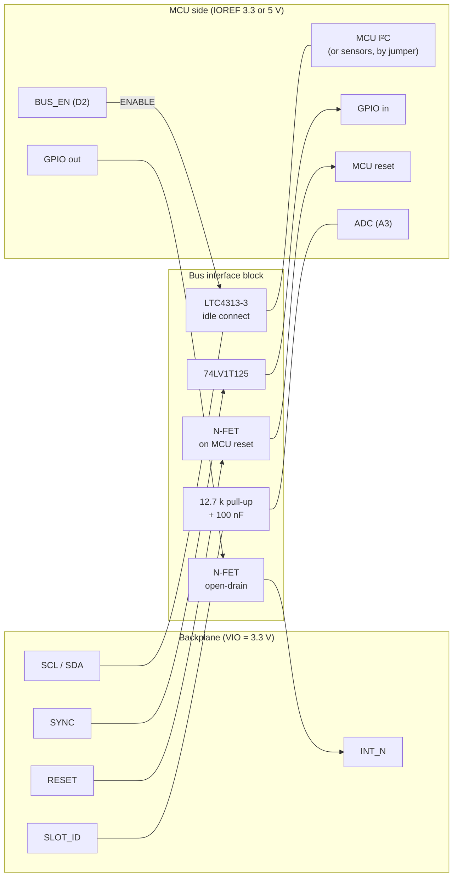

# 03 Bus and MCU Site

[RFC 0001](README.md) · previous: [02 Connectors](02-connectors.md) · next:
[04 Addressing](04-addressing.md)

## Bus interface block

Every G3 slice carries the bus interface block (BIB) between the backplane and
its MCU, on the back of the board under the 3.2 mm envelope. It costs roughly
$3–6 in parts (*estimate*; the LTC4313-3 is listed at $1.58 and $4.70 by two
distributors).

**BUS-1** The bus is I²C at 3.3 V on VIO, run at 50 kHz.

**BUS-2** Every slice MUST connect to SCL and SDA only through an LTC4313-3
(MSOP-8 or DFN-8) with no rise-time accelerator, as ADI's own bussed example
uses. It connects only when ENABLE is high and the bus has been idle
55–175 µs, translates 3.3↔5 V, goes high-impedance when unpowered, and
disconnects after 35–55 ms stuck low.

**BUS-3** ENABLE (BUS_EN) MUST come from an MCU pin with a 4.7 k pull-down on
the slice, so a slice in reset stays off the bus. 4.7 k is low enough for the
RP2350's erratum E9 (*verify*). Slice-side pull-ups are 4.7–10 k to IOREF.

**BUS-4** Firmware MUST keep the total clock stretch of one transfer under
30 ms, below the buffer's 35 ms minimum stuck-bus timeout.

**BUS-5** The head fits one 2.2 k pull-up pair per bus, removed when the
controller has its own (a Pi has 1.8 k on its first I²C bus).

**BUS-6** INT_N is open-drain and active low, pulled up to VIO on the head. A
slice drives it only through an N-FET, never from an MCU pin directly.

**BUS-7** SYNC is push-pull from the head; a rising edge means sample. A slice
receives it through a 74LV1T125.

**BUS-8** RESET is active high from the head and resets every slice. A slice
receives it through an N-FET that pulls its MCU's reset low. Driver enables
have pull-downs.

**BUS-9** The slice holds RESET and SYNC low with 100 k pull-downs, so an
unplugged chain resets and triggers nothing.

**BUS-10** SYNC and INT_N are optional per slice; the rest of the BIB is not.

**BUS-11** IOREF, the slice-side logic voltage, is set by the board variant's
BOM: 5 V for the Nano Every, classic and R4; 3.3 V for Nucleo, Pico and a
3.3 V Nano-site variant. There is no user jumper.

## MCU site

**MCU-1** The Nano-format socket and the Pico variant MUST use this map:

| Signal | Nano site | Pico variant | Notes |
| --- | --- | --- | --- |
| SDA / SCL | A4 / A5 | GP4 / GP5 (I2C0) | A deliberate break from the TEMP_PICO boards (GP20/21). |
| BUS_EN out | D2 | GP2 | The buffer's ENABLE; 4.7 k pull-down on the slice. |
| SYNC in | D3 | GP3 | Optional. |
| INT_N out | D6 | GP6 | Optional; through the FET. |
| WS2812 status LED | D9 | GP9 | Moves from D5 in today's spec. Clear of D7/D8 on Nucleo (*verify*). |
| SLOT_ID | A3 | GP28 / ADC2 | A native ADC pin everywhere. |
| D4 / D5 | never connected | — | They short to I²C on a stock Nucleo. |
| RESET | D-side RST | RUN | The analog-side reset position is BOOT1 on some boards. |
| V_ACT sense | any spare ADC | any spare ADC | Optional: V_ACT through a divider tells firmware the stack is stopped. |

**MCU-2** A board MUST be powered through the entry this table gives it:

| Board | Status | 5 V entry | Notes |
| --- | --- | --- | --- |
| Nano Every (ATmega4809) | 5 V reference | 5V pin | The fleet's current board. |
| Nucleo-32 L432KC | 3.3 V reference | +5V pin | The fleet's current board. |
| Pico 2 (RP2350, A4 stepping or later) | Pico reference | VSYS through a diode | Avoid A2 stock. Never rely on an internal pull-down (erratum E9). |
| Nano R4 (RA4M1, 5 V) | candidate | 5V pin (*verify*) | VIN needs 6 V or more. Becomes a reference once its I²C target mode (Arduino core issue #382) passes the bench. |
| Nucleo-32 G431KB | candidate | +5V pin (4.75–5.25 V, *verify* against UM1956) | CAN FD, unused in G3. |
| Nano classic (ATmega328P) | allowed | 5V pin | 2 KB of RAM. |
| Nano 33 BLE Rev2 / IoT | allowed, 3.3 V BOM only | VIN (4.5 V min) | Not 5 V tolerant, so only on a 3.3 V IOREF variant. The original Nano 33 BLE is end-of-life. |
| Nano ESP32 | excluded | — | VIN needs 6–21 V and it has no 5V input. |
| Nano RP2040 Connect | excluded | — | End-of-life. Its on-board chips sit on A4/A5; A6/A7 are read through the Wi-Fi module. |
| Nano Matter | excluded | — | I²C target mode is broken in its core. |

Pins left on the Nano site: of 22 (D0–D13, A0–A7), G3 takes A4/A5, D4/D5, D2,
D9 and A3, plus D3 and D6 if SYNC and INT_N are fitted. That leaves 13, or 15
without SYNC and INT_N. On the Every and R4, D0/D1 are Serial1, separate from
USB serial; on the Nano classic they are its USB serial, so it has two fewer
(*verify* on the Nucleo). A6/A7 are analog-only on the Every and classic.

## Sensor-carrier pattern

**SNS-1** For a slice that mainly carries fixed-address I²C sensors, jumpers
on the slice side of the BIB choose how they connect:

- **Direct:** the sensors appear on the bus and the controller drives them. No
  MCU is needed, and addresses must be unique.
- **Proxy:** the sensors sit on a private bus driven by the MCU, and the slice
  answers at its own address. Any number of identical sensors then work across
  slices without a multiplexer.

**SNS-2** A slice's own fixed sensors, like IAQM's, MUST go on its private
bus. A direct-mode sensor MUST NOT sit in the slice band, 0x10–0x1F.

**SNS-3** A Qwiic jack on a slice MUST connect only to its private bus. Nine
slices have one today: HEAT, IAQM, LVAI, PHDO, RLAY, SERV, THRM_31855,
THRM_31856 and USBP.

[bread-slice-core](https://github.com/feastorg/bread-slice-core) gets one
generic I²C-proxy family. ACAR, a power stage plus Atlas isolated EZO carriers
with an optional MCU for proxy mode, is the first user. AOEM stays the fully
custom route.
