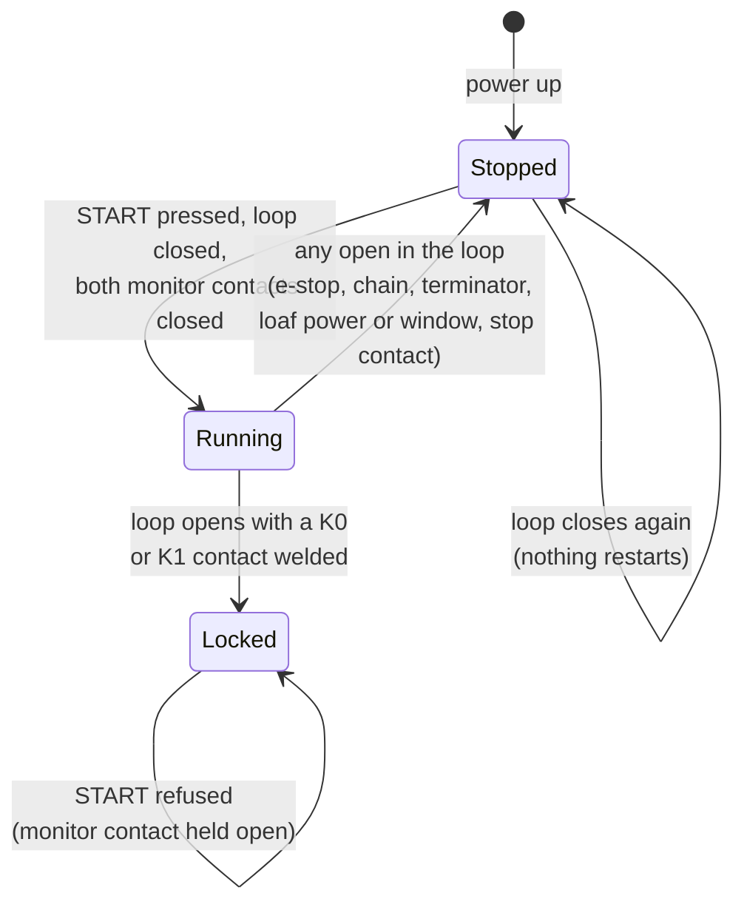

# 05 Stop and Interlock

[RFC 0001](README.md) · previous: [04 Addressing](04-addressing.md) · next:
[06 Power and ground](06-power.md)

The G3 stop is a **non-safety-rated interlock**. It is a relay start/stop
circuit: it powers up stopped, any open in its loop stops it, and only a
person pressing START restarts it. It is not certified to any functional-safety
standard. A certified safety relay can replace K0 and K1 later for a rated
stop, and a laser slice adds its own IEC 60825-1 interlock.

![The stop circuit. The 12 V stop supply runs through fuse F1, the e-stop and the stop contact, out on LOOP_OUT through each loaf's supply-held contact SH1 to SHn and the terminator plug, and back on LOOP_RET. From LOOP_RET, a seal-in path through K0a and K1a in series, and a start path through Rs, K0nc and K1nc that charges Cs, which START dumps into the coil node, feed the K0 and K1 coils. A second path from LOOP_RET through K0b, K1b and fuse F2 is RUN_FEED, which drives every loaf's RUN relay coil.](figures/stop-circuit.svg)

## Circuit

**STOP-1** The head's 12 V stop supply MUST run through a fuse of 1 A or less,
the e-stop's normally-closed contacts and the stop contact, then out LOOP_OUT
through every loaf's supply-held relay contact to the terminator plug, and back
on LOOP_RET.

**STOP-2** K0 and K1 MUST be force-guided relays, each with two normally-open
contacts and a normally-closed monitor contact. Their coils are fed by one of
two paths:

- **Seal-in:** from LOOP_RET through a K0 and a K1 normally-open contact in
  series.
- **Capacitor start:** a capacitor charges from LOOP_RET through a resistor
  and K0's and K1's monitor contacts in series, and START dumps it into both
  coils.

The resistor MUST be too large to pull the coils in on its own, and the
capacitor MUST hold them above pick-up for longer than either relay takes to
close. Both then seal, even though each monitor contact opens before its
normally-open contacts close. For two 0.5 W, 12 V coils, 1000 µF and 1.5 k
give 41 ms above 75 % of rated voltage, 1.05 V on the coils with START held,
and 4.5 s to recharge (*estimate*).

**STOP-3** RUN_FEED MUST be taken from LOOP_RET through the second K0 and the
second K1 normally-open contact in series, then a fuse of 1 A or less. RUN_FEED
drives each loaf's RUN relay coil, and that relay's contact cuts the loaf's
V_ACT rail. Because RUN_FEED comes from the loop, any open in the loop removes
it directly.

**STOP-4** The stop supply MUST deliver at least 0.6 A. The coil budget is up
to 1 W per loaf plus K0 and K1, about 0.45 A at 12 V with four loafs
(*estimate*).

**STOP-5** Every stop-circuit coil (K0, K1 and each loaf's RUN relay) MUST
have a diode plus a zener across it, so it releases fast. A plain diode on any
of them, or a one-way ESD diode on a stop line, would clamp the release and
slow every relay on that line, so ESD protection on the stop lines MUST be
bidirectional, with its standoff above the zener voltage.

**STOP-6** The stop contact is mandatory and energise-to-run: it closes only
while the controller drives its enable and RESET is low. A controller with no
spare output jumpers the enable and loses only the crash stop.

**STOP-7** On the loaf and the head, the stop loop and RUN_FEED MUST be routed
with a ground guard between them and any V_ACT or V_LOGIC copper; a short from
a supply rail onto them would hold the stop off. On the head, LOOP_RET, the
K0/K1 coil node and RUN_FEED MUST also be guarded from each other.

**STOP-8** Each RUN relay contact SHOULD open within 20 ms of the loop opening
(a target for the bench). How fast V_ACT then falls depends on the load.

## Behaviour

| Event | Result |
| --- | --- |
| Power-up | Stopped. |
| START with the loop open | Nothing energises. |
| E-stop, a chain joint opened, the terminator removed | Stops; stays stopped when the loop closes again. |
| A loaf losing power, or its input leaving its window | Its supply-held contact opens; the stack stops. |
| Controller crash or reboot, or RESET asserted | The stop contact opens; the stack stops. |
| START stuck or jumpered closed | Starts nothing: the capacitor can't recharge while START is held. |
| One K0 or K1 normally-open contact welded | The other relay drops on any open in the loop and breaks both series paths, so closing the loop restarts nothing. The welded relay's monitor contact is held open, so START can't restart the stack until that relay is replaced. |

Software can stop the stack but never restart it. The head reports no trip
location.

## Known limits

These follow from a non-safety-rated interlock:

- A wiring bridge on the head from LOOP_RET to the coil node or to RUN_FEED
  bypasses K0 and K1; STOP-7 guards those nets.
- A welded loaf RUN relay is not detected.
- A slice that resets on its own (its watchdog, a V_LOGIC PTC trip) reboots
  with V_ACT live, and a controller that re-sends its last command restarts
  that output.

## Outputs

**OUT-1** Every actuator output, own-terminal loads and dry contacts included,
MUST be energised only from V_ACT.

**OUT-2** Every actuator output MUST be off with its MCU unpowered or in reset,
by whatever bias its part needs: a pull-down on an N-FET gate or an
active-high enable, a pull-up on a P-FET gate or an active-low enable.

**OUT-3** Slices MUST NOT use latching relays for actuator outputs.

**OUT-4** Slice firmware MUST boot with its outputs off.

Slices no longer carry a stop receiver; firmware MAY read V_ACT through a
divider to know the stack is stopped ([03](03-bus.md#mcu-site)).

## Relay contacts

**OUT-5** The loaf RUN relay MUST carry and break the loaf's fused input
current, 20 A DC at 28 V into motor loads, because a slot short can trip the
stop before its slot fuse clears. The requirement is a DC inductive rating at
28 V, not an automotive 14 V rating.

**OUT-6** A slice MUST put at most 10 µF directly on V_ACT; anything larger
sits behind a soft-start on the slice, so the relay contacts don't close into a
capacitive surge.
