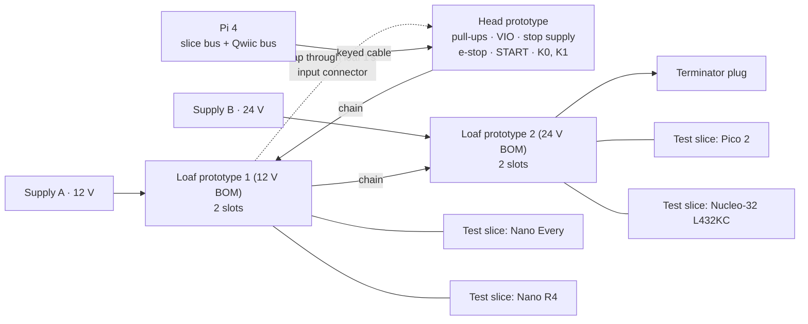

# 09 Bench Plan

[RFC 0001](README.md) · previous: [08 Migration and open work](08-migration.md)
· next: [10 Rationale](10-rationale.md)

Each test targets a claim this RFC makes that hasn't been measured. A test
passes only against its stated number. The RFC is accepted when T1–T9 pass, or
when it has been changed to match what they measured. Any case in which the
stack restarts on its own blocks acceptance.

Results are recorded per [bench records](../../spec/slice/bench-records.md):
what hardware, what firmware (with a hash), what was run, the raw output, and
the result against the pass line.

## Rig

- **Loafs.** Two slots each are enough. Both follow the one loaf design: the
  2×12 slot header, a RUN relay fed from RUN_FEED, a supply-held relay in the
  stop loop driven by the window detector, a 4 A fuse per slot, the TVS,
  position-line pull-ups and inverters, and the SLOT_ID FETs with the E96
  ladder. One is built with the 12 V BOM (10–15 V window), one with the 24 V
  BOM (19–28 V window).
- **Head.** The stop supply (a 12 V buck with full-duty pass-through), ≤1 A
  fuses on it and on RUN_FEED, an e-stop, START, K0 and K1 with their contacts
  as in [05](05-stop.md), the capacitor start, a diode plus zener on every
  coil, bidirectional TVS on the stop lines, and the stop contact driven from a
  Pi GPIO and opened by RESET.
- **Test slices.** A protoboard each: the BIB on adapters (LTC4313-3,
  74LV1T125, FETs), a 2×12 right-angle socket, and the MCU on headers. A load
  resistor or a DC motor on V_ACT through an FET whose gate is biased off in
  reset.
- **Simulated bus load.** Capacitors switched onto the backplane SDA/SCL stand
  in for 16 slices, about 250 pF in all.
- **Firmware.** One test sketch for all four MCUs: a CRUMBS target whose reply
  delay is settable (1–70 ms), which drives BUS_EN after boot, reads SLOT_ID 8×
  over 50 ms, reports V_ACT sense and SLOT_ID in its state reply, keeps its
  output off after boot until commanded, and toggles a pin on a SYNC edge.
- **Controller script.** N transactions per slice, counting CRC failures,
  NAKs, timeouts and duplicate addresses; optionally drives SYNC, RESET and the
  stop contact from GPIO; writes a CSV for the bench record.

## T1 Mixed MCUs through the buffer

Claims: the LTC4313-3 translates between 3.3 V and 5 V; a 5 V AVR, an RA4M1,
an RP2350 and an STM32 coexist on one 3.3 V bus at 50 kHz; the 30–70 % rise
time with 16 slices' worth of capacitance is ≤1 µs.

1. All four test slices on the bus, with the Pi's own 1.8 k pull-ups and the
   head's removed (BUS-5). Measure SDA/SCL high and low levels on both sides of
   one buffer.
2. 10 000 transactions per slice at 50 kHz; then at 100 kHz, to record the
   margin.
3. Switch in the 250 pF bank. Measure the 30–70 % rise time on the backplane
   SCL, and repeat the 10 000.
4. Measure the low level each card side sees while another slice drives low.
5. Move the slice bus to a Pi I²C controller with no on-board pull-ups (i2c6
   on GPIO22/23), fit the head's 2.2 k pair, and repeat the rise-time
   measurement with the bank (0.47 µs expected, *estimate*).

**Pass:** 0 failures at 50 kHz. Rise ≤1 µs with the bank, with either pull-up.
Card-side low below 0.8 V.

## T2 Clock stretching and the stuck-bus cut-off

Claims: stretching passes through the buffer; the buffer cuts a slice off
after 35–55 ms; the firmware contract is under 30 ms per transfer (BUS-4).

1. Set the reply delay to 1, 10, 25 and 30 ms: 1000 transactions each, on each
   MCU.
2. Set it to 40 and 60 ms. Scope SCL on both sides: when does the buffer
   disconnect, what does the controller read, and does the slice rejoin on its
   own?
3. Nano R4 alone: confirm its I²C target mode works with stretching (Arduino
   core issue #382).

**Pass:** 0 failures at ≤30 ms on all four MCUs. The disconnect lands inside
35–55 ms, and the slice recovers without a power cycle. If the R4 fails, it
stays a candidate.

## T3 Joining a busy bus

Claims: a slice whose MCU raises BUS_EN mid-traffic joins only at bus idle and
corrupts nothing; a slice in reset stays off the bus; a loaf powering up during
traffic corrupts nothing.

1. Stream continuous traffic to slice 1. Pulse slice 2's MCU reset 100 times,
   so it re-enables each time. Count corrupted transactions to slice 1, and
   measure the idle time before the buffer connects (55–175 µs expected).
2. Power loaf 2 up and down 20 times during traffic.
3. Hold slice 2 in reset and confirm its buffer stays disconnected (BUS_EN low
   through the 4.7 k pull-down). Repeat on the Pico 2 (erratum E9).

**Pass:** 0 corrupted transactions to slice 1 across all cycles.

## T4 Stop circuit

Claims: the stack powers up stopped; START can't start into an open loop; any
open in the loop drops every loaf's V_ACT; with any one K0 or K1 contact
welded, nothing restarts without START; a loaf losing power or leaving its
supply window stops the stack; RESET at the head stops it; a held START starts
nothing; a failed window detector stops the stack; software can stop but not
restart.

1. Power up the whole rig in every order. V_ACT stays off on both loafs until
   START is pressed.
2. Running, each of these must stop the stack and keep it stopped: the e-stop
   pressed; the chain unplugged at each joint; the terminator removed; the
   controller de-energising the stop contact; the controller rebooted; RESET
   asserted from the head; head power cycled.
3. With the loop open, press START. Neither K0 nor K1 may pull in, and no
   V_ACT may appear on any loaf.
4. Running, power-cycle loaf 2 while the controller keeps re-sending its last
   command. The stack must stop and stay stopped until START. Scope the load
   while the MCU boots: no pulse.
5. Simulate a weld on each K0 and K1 normally-open contact in turn: jumper it
   and the same relay's other normally-open contact, and lift its monitor
   contact, as a force-guided weld holds it open. Press the e-stop: every
   loaf's V_ACT must drop. Release it and watch V_ACT for 10 s before touching
   START: it must stay off. Then START must refuse.
6. Scope RUN_FEED as the e-stop opens, with every coil's diode plus zener
   fitted: it must swing to about the zener voltage, not clamp near −0.7 V.
7. Running, ramp loaf 2's supply slowly from nominal to 0 V and back, then up
   past the window's top and back. Record both trip points. The stack must
   stop at the window edge and stay stopped once the supply is back in window.
8. Try to join the two loafs OUT to OUT, and to fit the terminator on an IN.
   The keyed headers must refuse both.
9. Press START 1000 times, stopping between presses, at the lowest and the
   highest stop-supply voltage. Every press must latch both relays.
10. Hold START down, then open and close the loop. Nothing may restart.
11. Running, open the window detector's supply, then its output: the stack
    must stop each time. Step loaf 2's supply out of its window: the
    supply-held relay must drop within 10 ms.
12. Run the head from 12 V, then 24 V. Measure the stop supply and each loaf's
    coil voltage with both loaf relays pulled in.
13. Measure the time from the e-stop opening to each RUN relay contact
    opening, and to V_ACT falling below 1 V with a 3 A load.

**Pass:** every fault stops the stack and it stays stopped; only START
restarts it; a simulated weld on any one K0 or K1 contact neither keeps V_ACT
on through an e-stop nor restarts when the loop closes; the window trips at
10.0 and 15.0 V (12 V loaf) and 19.0 and 28.0 V (24 V loaf), within ±3 %;
RUN_FEED swings to the zener voltage on release; coil voltage within the
relay's rated range from both head supplies; each RUN relay contact opens
within 20 ms of the loop opening; every START press latches; a held START
starts nothing; a failed detector stops the stack, and a step out of window
drops the relay within 10 ms; the keyed chain refuses OUT to OUT and a
terminator on IN.

## T5 V_ACT path at 24 V

Claims: the loaf relay closes onto a bounded inrush; the per-slot 4 A fuse
clears a short and survives 3 A; a 24 V supply on a 12 V loaf keeps V_ACT off;
the RUN relay breaks its rated current into an inductive load; regenerated
motor energy is clamped; slice inputs survive the TVS clamp.

1. Fit 10 µF on V_ACT on each test slice, plus one slice with 470 µF behind a
   soft-start. Scope V_ACT and the input current as the relay closes. Record
   the peak inrush against the relay's contact rating.
2. From a 20 A supply, short one slot's V_ACT. The slot fuse clears. The stack
   may stop; START then restarts it with the other slots working.
3. Connect a 24 V supply to the 12 V loaf, from cold and then while running.
   V_ACT must stay off, or drop within 50 ms.
4. From the 20 A supply at 24 V, open the e-stop 100 times with the loaf
   drawing 12 A into an inductive load (a DC motor plus resistors), then 10
   times into a short behind the RUN relay at the supply's current limit.
   Measure the RUN relay's contact resistance before and after.
5. Check every test slice's V_LOGIC and V_ACT input parts are rated for 50 V or
   more.
6. With a DC motor on V_ACT, decelerate hard. Measure the V_ACT overshoot.
7. Measure contact and fuse temperatures after 30 min at 3 A per slot, inside
   a closed case.

**Pass:** inrush within the contact rating; a slot short clears only its slot
fuse, and START restarts the rest; a 24 V supply never holds V_ACT on a 12 V
loaf for more than 50 ms; the RUN relay's contact resistance stays within its
datasheet limit after all the breaks; regeneration stays below the window's
top (15 V or 28 V); contact and fuse temperatures stay within their datasheet
ratings.

## T6 Ground and noise under motor current

Claims: with one ground net and one floating supply per loaf, the chain ground
carries only signal and stop-coil current; I²C survives motor noise; one earth
reference is harmless, and two make a loop.

1. Motor at 3 A on loaf 2. Measure the current in the chain ground (a shunt in
   the ribbon's ground) and the ground offset between the two loafs.
2. Scope SDA/SCL with a logic analyzer decoding, during motor start, reversal
   and stall, while the 10 000-transaction loop runs.
3. Plug a USB cable from an earthed PC into the motor slice's MCU and repeat.
   Then add an earthed supply on the other loaf, to record the loop GND-2
   forbids.

**Pass:** chain ground current ≤50 mA beyond the stop circuit's coil current
(measured with the motor off and subtracted), and 0 I²C failures during motor
events with one earth reference. If failures appear, the record says what the
scope showed.

## T7 SLOT_ID and loaf position

Claims: the 18-bin ladder decodes reliably at IOREF 3.3 V and 5 V; position
lines switch the loaf's ladder; open, short and no-position states never decode
to a valid address.

1. Fit the E96 1 % ladder with 12.7 k pull-ups. Read every slot on both loafs
   from each MCU, 100 reads each. Record the spread as a fraction of full scale.
2. Swap loaf order on the chain. The addresses must follow position.
3. With the head unplugged (no line grounded), with SLOT_ID open, and with it
   shorted: no slice joins.
4. With the head plugged in (VIO present) and its POS1 ground lifted, as a
   fifth loaf would see: no slice joins.
5. A 24 V loaf chained after a 12 V loaf, with one loaf unpowered: check the
   position-line levels and back-feed.

**Pass:** worst-case reading at least 1.5 % of full scale inside its bin on
every MCU (the RFC estimates 2.08 %, before ADC error); invalid states never
join; no back-feed into an unpowered loaf.

## T8 MCU power entry

Claims: the Nano Every and R4 run from their 5V pin, the Nucleo-32 from +5V,
and the Pico 2 from VSYS through a diode; nothing back-feeds USB.

1. Feed each board from the slice's 5 V, with and without USB plugged in.
   Measure the current flowing back into the USB host port.
2. Nano R4: confirm it boots and runs from its 5V pin alone (its VIN needs 6 V
   or more).

**Pass:** each board runs from the slice's 5 V, with back-feed into the USB
host port at most 100 µA. A reference board that fails blocks acceptance; a
candidate that fails stays a candidate.

## T9 Guide and keys

Claims: the closed-U loaf guide fixes position and row before the pins touch;
the keys block reversal; the voltage key blocks 12 V-only slices on a 24 V
loaf.

1. Print the loaf guide and the bench guide with the U closed on both sides.
   Measure the guided travel before first pin contact (6.35 mm expected).
2. With bare boards, try reversed, row-shifted and offset insertions. No pin
   may touch a wrong pin.
3. Check that the 2×12 body clears the loaf's locating holes (about 0.45 mm
   expected).
4. Test the chosen hole-blocking method: can it be pulled out by hand?

**Pass:** no wrong-pin contact in any attempt. The clearance is measured, not
assumed.

## Order

1. **T9** first: the guides are a print and some headers, and the result
   changes the slot geometry before any copper exists.
2. **T1–T3** next, on one loaf. If the LTC4313-3 fails, the RFC changes before
   anything else gets built.
3. **T8** alongside, on the same test slices.
4. **T4 and T5**: the stop circuit and V_ACT; these need the second loaf and
   supply.
5. **T6 and T7** last: two loafs, motor current, and the ladder.

## Parts

Each part is a requirement plus a candidate. Candidates marked *verify* haven't
been checked against a datasheet. Quantities cover two loafs, one head and four
test slices, with spares.

| Item | Requirement | Candidate | Qty |
| --- | --- | --- | ---: |
| Bench supplies | 0–30 V, ≥5 A, current limit, independent and floating | Korad KA3005D or Riden RD6006 class | 2 |
| High-current supply | 24 V, ≥20 A, for fuse clearing, the break test and the heat test | Mean Well LRS-600-24 class (*verify*) | 1 |
| 5 V reference MCU | Nano Every | Arduino Nano Every | 1 |
| 3.3 V reference MCU | Nucleo-32 on the Nano grid | NUCLEO-L432KC | 1 |
| Pico-site MCU | RP2350, A4 stepping or later | Raspberry Pi Pico 2 (check the stepping marking) | 2 |
| 5 V candidate MCU | Nano format, 5 V I/O | Arduino Nano R4 (ABX00142) | 1 |
| Bus buffer | idle-connect, 3.3↔5 V, no rise-time accelerator | LTC4313CMS8-3 (MSOP-8) | 10 |
| SYNC buffer | works at 3.3 V and 5 V | SN74LV1T125DBV | 6 |
| Small FETs | INT, RESET, SLOT_ID (RDS(on) ≤10 Ω at 3.0 V), position-line inverters, load gates, supply-held relay drive (≥60 V) | BSS138 for SLOT_ID (*verify* RDS(on) at 3.0 V); 2N7002 for the relay drive and elsewhere | 50 |
| Head relays K0 and K1 | force-guided, 12 V coil, 2 NO plus 1 NC monitor, ≥1 A | a force-guided safety relay, 2NO+1NC class (*verify*) | 3 |
| E-stop and START | e-stop with NC contact; momentary NO button | 22 mm panel e-stop; generic momentary | 1 + 1 |
| Stop supply | 12–30 V in, 12 V out ≥0.6 A, passes 12 V through at full duty | a buck module with 100 % duty cycle (*verify* dropout) | 1 |
| Loaf RUN relay | 12 V coil ≤1 W; contacts carry and break ≥20 A DC inductive at 28 V | a DC-rated power relay (*verify* the DC rating) | 2 |
| Supply-held relay | coil at the loaf's class (12 or 24 V) through a ≥60 V FET, with a diode plus zener; contact ≥1 A at 12 V | a small signal relay per class | 2 + 2 |
| Slot fuses | 4 A, replaceable, with holder | mini-blade or 5×20 mm with holder | 8 |
| Input fuse | 20 A, with connector and wiring to match | blade fuse and holder | 2 |
| Window detector | ±3 %, with hysteresis, an actively driven output, and a ≥50 V-input supply | TLV7032 push-pull comparator, TL431 reference, TPS7A16 60 V LDO (*verify*); open-drain supervisors such as the TLV6700 do not meet the output rule | 2 |
| TVS | loaf input and V_ACT: 28 V standoff, clamp below 50 V; stop lines: bidirectional, standoff above the coil zener | SMBJ28A; SMBJ18CA with 15 V coil zeners (*verify*) | 6 + 4 |
| PTC | V_LOGIC per slot: 0.75 A hold, 60 V-class | a 60 V 0.75 A part, 1812 or radial (*verify*) | 4 |
| Slot connectors | 2×12, 2.54 mm: vertical male on the loaf, right-angle female on the slice | generic, or Samtec TSW/SSW (*verify* the row pitch of the right-angle socket) | 4 + 6 |
| Chain | shrouded, polarised 2×12 box header and IDC ribbon; IN and OUT keyed (CON-8) | 2×12 box headers, IDC sockets, 10 cm ribbon | 4 + 4 |
| Adapters | MSOP-8 and SOT-23 to DIP | generic breakout boards | 20 |
| Passives | 1 % E96 for the SLOT_ID ladder (12.7 k and the 16 table values), E24 otherwise; 10 µF 50 V ceramics; 470 µF 50 V electrolytic; 100 nF; 15 V zeners; 1000 µF 25 V and 1.5 k for the capacitor start | a resistor kit plus capacitors | kit |
| Loads | 3 A at 12 V and at 24 V | 4 Ω and 8 Ω 50 W resistors, or a DC motor | 2 |
| Protoboard | double-sided 2.54 mm perfboard | generic | 8 |
| Guides | loaf guide and bench guide, U closed on both sides | the bread-mechanical backplane part, modified | 2 + 1 |
| Instruments | oscilloscope; logic analyzer with I²C decode | any | — |

Rough cost, excluding supplies and instruments: about $250–400 (*estimate*,
not quoted). The three supplies add about $220–330 (*estimate*).
