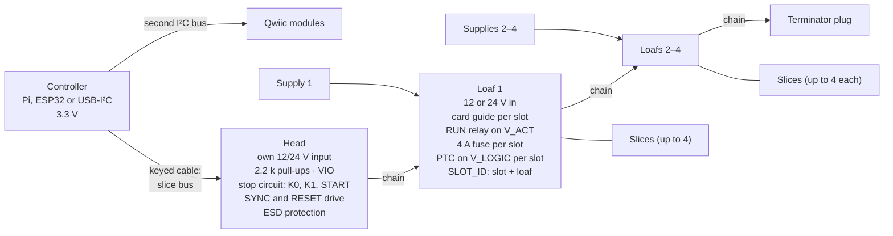

# 01 System

[RFC 0001](README.md) · next: [02 Connectors](02-connectors.md)

The head is a chained board, not a slot. Each loaf takes its own 12 V or 24 V
supply. The chain carries signals, ground, the position lines, the stop loop
and RUN_FEED, never a supply rail.

## Head

**SYS-1** The head MUST carry:

- its own 12 V or 24 V power input, or a tap through loaf 1's input
  connector, never a second lead from loaf 1's supply;
- the keyed cable header to the controller
  ([02](02-connectors.md#controller-cable)), and one or two Qwiic jacks on a
  second controller I²C bus;
- the slice bus's single removable 2.2 k pull-up pair, and the VIO regulator
  (3.3 V ±5 %, up to 160 mA for 16 buffers, *estimate*);
- a 12 V buck for the stop circuit that passes a 12 V input straight through
  at full duty;
- the stop circuit of [05 Stop](05-stop.md);
- the INT_N pull-up (10 k to VIO) and its input to the controller;
- the SYNC driver (push-pull at VIO; a rising edge means sample; high for at
  least 10 µs) and the RESET driver (push-pull, active high, for at least
  10 ms, with a pull-down so an unpowered head resets nothing);
- ESD protection on everything that leaves the box, bidirectional on the stop
  lines with its standoff above the coil zener voltage.

## Loaf

**SYS-2** An SI2 loaf MUST carry:

- a card guide per slot ([02](02-connectors.md#card-guide-and-keys));
- an input connector, wiring and fuse for its full load: up to 4 × 3 A of
  V_ACT plus 4 × 0.5 A of V_LOGIC, 14 A (*estimate*), on a 20 A fuse;
- a window detector and a supply-held relay
  ([06](06-power.md#loaf-input));
- a RUN relay fed from RUN_FEED, cutting the V_ACT rail, then a replaceable
  4 A fuse per slot, and an SMBJ28A-class TVS on the loaf input and on the
  V_ACT rail ([05](05-stop.md), [06](06-power.md));
- a 60 V-class PTC on V_LOGIC per slot, 0.75 A hold;
- the SLOT_ID network ([04](04-addressing.md#slot_id));
- CHAIN IN and CHAIN OUT headers ([02](02-connectors.md#chain-connector)).

There is one loaf design with two BOMs, one per voltage class: the window
thresholds and the supply-held relay's coil change with the class.

**SYS-3** A loaf with its own controller, like
[Loaf_x008](https://github.com/feastorg/Loaf_x008) and its Arduino Nano, is a
head and a loaf on one board. It MAY be built if it carries everything SYS-1 lists for a head.

## Slice

A slice carries the bus interface block ([03](03-bus.md)), an MCU site, its
own V_LOGIC regulation, and its function. Its actuator outputs follow the
outputs and V_ACT rules in [05](05-stop.md#outputs).

## Capacity

**SYS-4** A stack has at most four loafs and 16 slices. Four position lines
give four loafs; a fifth loaf needs a new addressing scheme.

The bus runs at 50 kHz, provisionally. What limits it is not signal margin
but how the controller handles each target's clock stretch, together with how
long each target's firmware masks interrupts; the measurements are in
[03](03-bus.md#bus-integrity). Electrically the bus would reach about 100 kHz
(*estimate*: 0.38 µs 30–70 % rise with a Pi's 1.8 k and about 250 pF; 0.47 µs
with the head's 2.2 k).
