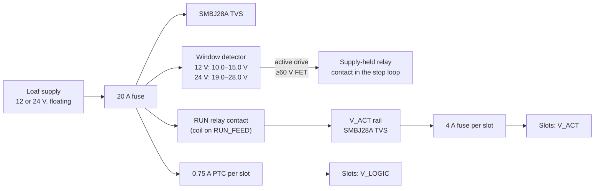

# 06 Power and Ground

[RFC 0001](README.md) · previous: [05 Stop and interlock](05-stop.md) · next:
[07 Mechanical](07-mechanical.md)

## Rails

| Rail | Slot pins | Budget | Protection |
| --- | --- | --- | --- |
| V_LOGIC (12/24 V) | 1 | 0.5 A per slot | A 60 V-class PTC per slot, 0.75 A hold. |
| V_ACT (stop-switched) | 2 | 3 A per slot | The loaf's RUN relay, a replaceable 4 A fuse per slot, and an SMBJ28A-class TVS on the rail. |
| Own terminal | front I/O | as the load needs | Switched from V_ACT on the slice; current returns through the terminal. |

**PWR-1** Each loaf runs at 12 V or 24 V, set by its BOM and shown by its
voltage key ([02](02-connectors.md#card-guide-and-keys)).

**PWR-2** A slice MUST accept 9–30 V on V_LOGIC, and every slice part on
V_LOGIC or V_ACT MUST survive 50 V; the loaf TVS clamps at 45.4 V.

**PWR-3** V_LOGIC and V_ACT MUST be fed to each slot through the protection in
the table.

## Loaf input

**PWR-4** The loaf input connector, wiring and fuse MUST be rated for the full
load: up to 4 × 3 A of V_ACT plus 4 × 0.5 A of V_LOGIC, 14 A (*estimate*), on a
20 A fuse.

**PWR-5** A window detector after the input fuse MUST hold the supply-held
relay only while the input is inside its window: 10.0–15.0 V on a 12 V loaf, or
19.0–28.0 V on a 24 V loaf, ±3 %, with hysteresis, for supplies within ±5 % of
nominal. Outside the window the relay MUST drop within 10 ms. A brownout or a
wrong supply then opens the stop loop, so V_ACT stays off.

**PWR-6** The detector MUST run from a regulator rated for 50 V or more at its
input, and the relay MUST be held only by an actively driven output, so an
unpowered or failed detector, or an open output, drops it. The relay's driver FET MUST be
rated for 60 V or more, and its coil MUST have a diode plus a zener across it.

**PWR-7** An SMBJ28A-class TVS (28 V standoff, 31.1 V minimum breakdown,
45.4 V clamp) MUST sit on the loaf input and on the V_ACT rail, in both voltage
classes.

## Ground

**GND-1** A stack has one ground net. Each loaf MUST have its own supply with a
floating output, feeding nothing else, so its load current returns to that
supply. The head has its own supply, or taps through loaf 1's input connector.

The chain ground carries signal current plus the stop circuit's coil currents
(under 0.5 A, *estimate*).

**GND-2** A stack MUST have at most one earth reference. An earthed supply, a
Pi on an earthed supply, and a USB cable to a PC each count as one; two make a
loop through the chain ground. Current sensing on motor slices stays
differential.

**GND-3** A USB cable to a slice is the stack's earth reference while it's
plugged in, so to flash a slice in a powered stack the controller and every
supply MUST float. Otherwise flash with the stack unpowered.

This is a cost against Slice Interface 1, where a slice came off the
backplane to be flashed: under SI2 each reflash powers its loaf off, stopping the loaf's other
slices, or needs every supply floating. A slice MAY offer a bus bootloader,
flashed through the controller over I²C, which needs neither. A programming
header (UPDI or SWD) in the front I/O zone avoids the earth loop only with an
isolated programmer.

## Regenerated energy

Motors can push energy back onto V_ACT and, through the closed RUN relay, onto
the loaf input, where it can trip the window and stop the stack.

**PWR-8** Motor slices MUST clamp their own regenerated energy below the
window's top: 15 V on a 12 V loaf, 28 V on a 24 V loaf. The clamp itself is
still to be specified.

## Mains and isolation

**ISO-1** Mains MAY appear only in a slice's front I/O zone, on relay contacts
or a sensing transformer (RLAY, RLHT and VCAC do today), behind a creepage
keep-out sized for reinforced insulation at 250 V. The distance is still to be
specified.

**ISO-2** Nets in the bus, BIB, MCU or power zones MUST NOT share a path
with mains.

**ISO-3** An isolated slice (ACAR, AOEM) MUST put its barrier between the BIB
and the isolated side; SI2 ground connects only to the bus side.
