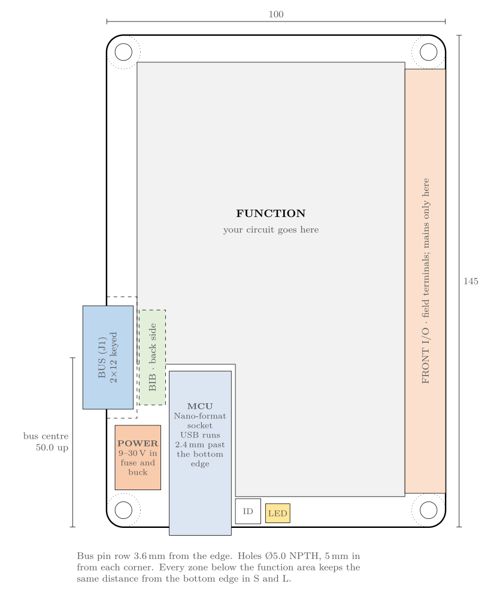

# 07 Mechanical

[RFC 0001](README.md) · previous: [06 Power and ground](06-power.md) · next:
[08 Migration and open work](08-migration.md)

## Formats and datums

SI2 keeps the board formats of Slice Interface 1 as the G2 boards set them
([SI1: Slice board formats](../../spec/slice/slice-interface-1.md#slice-board-formats)):
the S and L outlines, the bus row centre at x 3.6, y 50.0, and Ø5.0 NPTH
holes 5 mm from each edge. Of the 40 slices, 37 already put the bus row
there. SI1 leaves several things open that SI2 fixes here: the bus
connector's reference (MEC-3), board thickness (MEC-4), a keep-out around the
holes (MEC-2), and the case envelope (MEC-5).

**MEC-1** A slice is S (70 × 100 mm) or L (100 × 145 mm), with R5 corners.
FPSG is 100 × 100 today; it moves to L, or the standard gains a third format.

**MEC-2** Mounting holes are Ø5.0 NPTH, 5 mm in from each corner, with a 5 mm
keep-out radius.

**MEC-3** The bus pin row sits 3.6 mm from the edge and 50.0 mm up from the
bottom edge, and the bus connector is J1.

**MEC-4** Boards are 1.6 mm thick, 1.8 mm at most.

**MEC-5** The case envelope is 21.6 mm above the board and 3.2 mm below, at
30.4 mm slot pitch (29.6 mm case). Through-hole parts stay on the top side;
the bottom side takes SMD parts up to 3.2 mm, including the BIB.

**MEC-6** The ID block carries the standard BREAD and OSHW marks.

**MEC-7** A slice's own daughter-card connector, like STPC's card edge, is
private to the slice and outside the standard.

## Zones

Both maps are proposals, drawn over the existing fleet's layouts.

**MEC-8** A slice SHOULD follow the zone map for its format: bus and BIB at the
bus edge, power below the bus, the MCU socket with its USB at the bottom edge,
field terminals in the front I/O zone, and the function in between. In S and L,
every zone below the function area keeps the same distance from the bottom
edge, so the bus, power and MCU line up across formats in a loaf.

## Manufacturing

**MEC-9** SI2 boards are designed fab-first: for a PCB house and PCBA, not for
milling. Each board repo produces PCBA outputs in CI, and each IOREF variant is
its own BOM.

## Generations and versions

Slice Interface 2 is an interface, not a board generation. Generations (G1,
G2, G3…) count rounds of BREADS hardware and revisions (r1, r2…) count respins
within one;
[terminology](../../spec/terminology.md#generations-revisions-and-interfaces)
defines all three labels. Every board from G1 to G3 uses Slice Interface 1.
The first boards built to SI2 are G4.

**VER-1** The interface carries its own version. A change that keeps every SI2
board working bumps the minor number (SI2.1); a change that breaks one, such
as a pin-map change, is Slice Interface 3.
